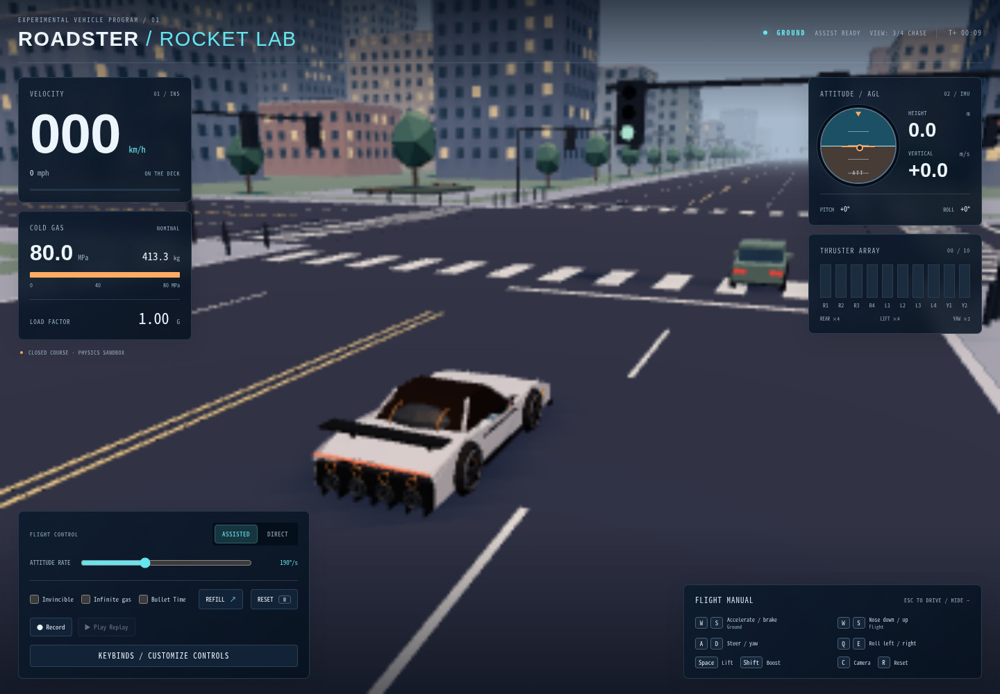

# Tesla Roadster 2 Rocket Simulator

[English](README.md) | [简体中文](README_ZH.md)

基于 Three.js 打造的纯浏览器端 **Tesla Roadster SpaceX Package（冷气推进器套件）低多边形飞行物理模拟器**。

零外部 npm 运行时依赖，提供完全自包含的单一离线 `.html` 版本，支持本地直接双击（`file://`）运行。



## 🎮 操控指南

### 1. 地面驾驶模式（Ground Mode）

| 按键 / 控制 | 动作说明 |
|---|---|
| **W** / **S** | 电驱加速 / 刹车与倒车 |
| **A** / **D** | 前轮阿克曼几何转向（向左 / 向右） |
| **Shift**（按住） | 激活尾部 4 个推进器（R1–R4），开启尾推火箭加速 |
| **Space**（按住） | 激活底部 4 个升力推进器（L1–L4），进行垂直起跳并转入飞行 |
| **R** | 一键瞬间重置车辆位置与姿态至出发路口起点 |
| **C** | 循环切换相机视角（3/4 Chase → Direct Chase → Top-down → Orbit） |

### 2. 飞行模式（Flight Mode）

离地超过 0.15 秒后，飞控系统自动接管姿态：

| 按键 / 控制 | 动作说明 |
|---|---|
| **W** / **S** | 俯仰控制（Pitch）：**W** 低头 / **S** 抬头（通过前后升力喷口差动实现） |
| **A** / **D** | 偏航控制（Yaw）：**A** 向左偏航 / **D** 向右偏航（通过车头侧向 Y1/Y2 喷口喷射） |
| **Q** / **E** | 横滚控制（Roll）：**Q** 向左滚转 / **E** 向右滚转（通过左右升力喷口差动实现） |
| **Space**（按住） | 升力推力主油门：提供垂直上升与悬停升力 |
| **Shift**（按住） | 空中尾推全开：提供强劲的空中前向火箭加速 |

> **提示**：若起飞时仍按住油门 W 键，系统会暂时锁定 Pitch 轴并提示 `RELEASE [W] TO ENGAGE PITCH`，松开按键后即可自由俯仰。

### 3. 手柄支持（标准映射）

Xbox / DualShock / DualSense 类手柄即插即用，连接后 HUD 顶部显示 `PAD: <设备名>`。摇杆与扳机为全模拟量（摇杆死区 0.14、扳机 0.05，区内归零、区外重标定到满量程），可与键盘叠加输入。

| 手柄 | 地面 | 飞行 |
|---|---|---|
| **左摇杆** | 模拟转向（左 ≡ A）／Orbit 相机旋转 | 偏航（左 ≡ A） |
| **右摇杆** | Orbit 相机（飞行模式之外） | 俯仰（后拉 ≡ S 抬头）／滚转（右 ≡ E） |
| **RT**（右扳机） | 模拟油门（≡ W） | 尾部火箭助推（≡ Shift） |
| **LT**（左扳机） | 刹车／倒车（≡ S） | 模拟升力（≡ Space） |
| **A / LB** | 升力喷口 | 请求升力 |
| **X** | 助推 | 助推 |
| **Y** | 切换相机 | 切换相机 |
| **View / Select** | 重置车辆、姿态与气罐 | 重置 |
| **D-pad ↑ / ↓** | 缩放 Orbit 相机（3–35m） | 缩放 Orbit 相机 |

手柄与键盘共享同一物理、起飞互锁与反转管线：飞行轴反转同样作用于手柄摇杆，起飞瞬间按住俯仰摇杆会触发相同的 Pitch 锁定。振动反馈（撞击／坠毁／发射／助推）默认开启（`joypad.js`），不支持的设备静默降级。手柄映射固定，改键仅作用于键盘。

### 4. 特殊玩法与作弊选项（HUD / Settings 面板）

- **Orbit 自由相机**：切换至 Orbit 视角后，在画布上按住鼠标左键（或触控）拖拽即可自由 360° 旋转视角，滑动滚轮可自由拉近/推远镜头。
- **Bullet Time（子弹时间）**：在设置面板勾选后，在空中享受 0.5x 慢镜头特技操控。
- **Record / Play Replay（轨迹录制与回放）**：
  1. 点击 HUD 左侧「Record」开启录制；
  2. 驾驶车辆完成任意动作后，点击「Stop Recording」；
  3. 按 `R` 键重置车辆后，HUD 会出现「▶ Play Replay」按钮，点击即可进行回放；按 `Esc` 或点击「Exit Replay」可随时退出。
- **Invincible（无敌模式）**：勾选后免除任何速度、倾角或底盘击穿坠毁判定。
- **Infinite Fuel（无限燃料）**：锁定 80 MPa 气瓶压力，喷射不消耗冷气质量。
- **KEYBINDS（按键与反转设置）**：点击 HUD「KEYBINDS」按钮可自定义 12 项动作键位，并可单独开启飞行 Pitch/Yaw/Roll 输入反转，设置自动保存至 `localStorage`。

---

## 🚀 快速开始与运行

### 方式一：单文件独立版（无需任何开发环境或服务器）
直接双击打开以下自包含 HTML 文件即可在浏览器中完整运行：
```text
roadster-lab/dist/roadster-rocket-standalone.html
```
- 体积约 1.56 MB，内联全部 21 个运行模块（含本地附带的 `gamecontroller.js` / `joypad.js` 手柄库）、CSS 与 Three.js 脚本；
- 彻底解除浏览器 `file://` 协议下的 CORS 限制，单文件随处可玩。

### 方式二：静态 HTTP 服务运行
```bash
cd roadster-lab
# 使用内置启动脚本启动静态服务器（默认 8080 端口）
npm start
# 浏览器访问：http://127.0.0.1:8080/
```

### 方式三：重新构建单文件分发版
```bash
cd roadster-lab
# 零外部 npm 依赖打包
npm run build
# 或使用别名：
npm run build:single
```

---

## 🧪 测试与质量保证

本项目包含完整的自动化物理与飞控单测套件及无头 Chromium 浏览器回归测试：

```bash
cd roadster-lab

# 1. 运行 148 项物理、动力学与飞控闭环单测
node --test scripts/test-simulator.mjs

# 2. 运行 14 项手柄输入／合并／互锁／震动单测
node --test scripts/test-gamepad.mjs

# 3. 运行 17 项单 HTML 打包器构建测试
node --test scripts/test-single-html.mjs

# 4. 运行 DOM 状态与资产校验
node scripts/check-ui-state.mjs
npm run check

# 5. 运行单文件离线 Chromium 自动化测试（需 python3 与 playwright）
python3 scripts/test-standalone.py

# 6. 运行主应用 Chromium 浏览器全量交互测试
python3 scripts/test-browser.py
```

---

## 📄 许可证

本项目遵循 MIT 许可证。内置 Three.js (r170)、gamecontroller.js 与 joypad.js 遵循其官方 MIT 许可。
